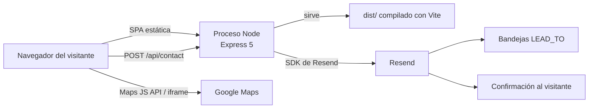

<div align="center">
  
  <h1>ROSE Technology — Sitio corporativo</h1>
  <p><b>Sitio corporativo de una sola página con API de contacto, mapas multi-sede y nueve idiomas</b><br/>Desarrollado para ROSE Technology, centro de reparación y optimización de sistemas con sedes en Villavicencio, Bogotá y Cali</p>

  <p>
    <a href="README.md"></a>
    <a href="README.es.md"></a>
  </p>

  
  
  
  
  
  
  <a href="LICENSE"></a>

  <p>
    <a href="ARCHITECTURE.md">Arquitectura</a> ·
    <a href="SECURITY.md">Seguridad</a> ·
    <a href="CHANGELOG.md">Changelog</a>
  </p>
</div>

<details>
<summary><b>English summary</b></summary>

Corporate website for ROSE Technology, a business systems repair and optimization center with branches in Villavicencio, Bogotá and Cali (Colombia). It is a single-page Vite + React 19 + TypeScript app with a small Express 5 API that sends contact leads through Resend, Google Maps for branch locations and coverage areas, a custom i18n layer with nine languages and light/dark themes. Production runs as one Node process in a Docker image on Render. Version 1.0.0 was delivered in August 2026. The full English README is in [README.md](README.md).

</details>

## Qué es

Sitio institucional de **ROSE** (marca comercial **ROSE Technology**, Centro de Reparación y Optimización de Sistemas Empresariales), empresa que repara y mantiene equipos de cómputo empresariales y comercializa el software administrativo **Myshop**. Tiene tres sedes: Villavicencio (principal), Bogotá y Cali.

El objetivo es un sitio tipo folleto, rápido, que convierta visitas en contactos comerciales: presenta los servicios, Myshop, los productos y el equipo, muestra en un mapa la cobertura de cada sede, ofrece el catálogo comercial en PDF y envía cada solicitud de contacto por correo al equipo comercial. No hay cuentas de usuario, pagos ni base de datos: el correo es el registro de los leads.

## Funcionalidades

| Área | Qué hace |
| --- | --- |
| Contenido | Una sola página con secciones de inicio, quiénes somos, servicios, Myshop, productos, por qué elegirnos, equipo, cobertura y contacto; navegación fija con scroll-spy y menú lateral en móvil. |
| Sedes y mapas | Selector de sede (Villavicencio, Bogotá, Cali). `LocationMap` ubica cada sede con la API JavaScript de Google Maps, o con un iframe embebido si no hay clave. `CoverageMap` dibuja la cobertura presencial y remota a partir de `src/data/coverage.json`. |
| Formulario de contacto | Temas cerrados (diagnóstico, cotización, Myshop, productos, asesoría, mantenimiento), validación en cliente y servidor, campo honeypot oculto, límite de envíos, correo del lead a `LEAD_TO` y confirmación al visitante con Resend. |
| Catálogo | `BrochureDownload` sirve `public/catalogo-rose-technology.pdf` desde la cabecera, el menú y el pie. |
| Internacionalización | Nueve idiomas (español por defecto, inglés, francés, chino simplificado, portugués de Brasil, alemán, japonés, italiano y coreano) con un `I18nProvider` propio y archivos JSON, sin i18next. La preferencia se guarda en `localStorage`. |
| Tema | Claro y oscuro, detección inicial con `prefers-color-scheme`, persistencia en `localStorage` (`rose-theme`) y un script temprano en `index.html` que fija `data-theme` y `color-scheme` antes del primer pintado (evita problemas con Force Dark de Samsung Internet). Mapas y logos siguen el tema. |
| SEO y privacidad | JSON-LD `LocalBusiness`, aviso de cookies y registros de producción sin datos personales del formulario. |

## Arquitectura



- **Una sola unidad de despliegue.** En producción un único proceso Node sirve el build de Vite (`dist/`) y las rutas `/api`: un contenedor, un `PORT` y una URL en el plan gratuito de Render. En local, `npm run dev` levanta Vite y Express en paralelo y Vite reenvía `/api`.
- **Frontera clara entre cliente y servidor.** La clave de Resend solo la lee Node y nunca lleva prefijo `VITE_`. La clave de Google Maps es pública por diseño, se incrusta en el build y debe restringirse por HTTP referrer.
- **Sin base de datos.** Los leads llegan a las bandejas de `LEAD_TO` (con `CEO_EMAIL` como respaldo); idioma, tema y cobertura viven en `localStorage` y en GeoJSON versionado.
- **Endpoint de contacto protegido.** Helmet con CSP estricta, lista blanca de CORS, cuerpo limitado a 16 KB, rechazo de campos JSON no declarados, límite de 5 envíos por IP cada 15 minutos (configurable) y plantillas de correo con HTML escapado.
- **Cobertura desde OpenStreetMap.** `scripts/fetch-coverage.mjs` consulta Overpass en la máquina de desarrollo y escribe los polígonos en `src/data/coverage.json`; el navegador nunca llama a OSM.

Motivos de diseño, flujo de datos e infraestructura en detalle: [ARCHITECTURE.md](ARCHITECTURE.md).

## Stack tecnológico

| Capa | Tecnología |
| --- | --- |
| Interfaz | Vite 7, React 19, TypeScript 5.9, CSS propio (negro, blanco y rojo `#e10600`) |
| API de contacto | Express 5 (`server/index.mjs`), Helmet, CORS, express-rate-limit |
| Correo | SDK de [Resend](https://resend.com/), solo en el servidor |
| Mapas | Google Maps JavaScript API, con iframe de Maps Embed como respaldo |
| i18n | `I18nProvider` propio + JSON por idioma |
| Empaque | Imagen Docker multi-etapa (`node:20-alpine`), Docker Compose |
| Alojamiento | Render, plan gratuito, runtime Docker (`render.yaml`) |

## Puesta en marcha

Requisitos: Node.js 20 o superior.

```bash
npm install
```

Copia `.env.example` a `.env` en la **raíz** del repositorio y completa los valores. No crees `src/.env` ni uses el prefijo `VITE_` para secretos.

```bash
npm run dev
```

Ese comando levanta dos procesos: la API de contacto en `http://127.0.0.1:8787` y Vite en `http://localhost:5173`, que reenvía `/api` a Express.

Compilación solo del frontend:

```bash
npm run build
npm run preview
```

`npm run preview` sirve `dist/` y sigue reenviando `/api` a una API que debe estar corriendo aparte. En producción usa `npm start` (o Docker) para que un solo proceso sirva `dist/` y la API.

### Scripts

| Script | Qué hace |
| --- | --- |
| `npm run dev` | API + Vite en paralelo (`concurrently`) |
| `npm run dev:web` | Solo Vite |
| `npm run dev:api` | Solo Express |
| `npm run build` | Comprueba TypeScript y genera `dist/` |
| `npm run preview` | Sirve `dist/` con proxy a la API |
| `npm start` | Producción: estáticos `dist/` + `/api` |

### Variables de entorno

Nombres y propósito documentados en `.env.example`. Nunca copies claves reales al README, a issues, a PDFs ni a `render.yaml`.

**Servidor (secretos)**

| Variable | Propósito |
| --- | --- |
| `RESEND_API_KEY` | Clave de la API de Resend. Solo la lee Node. |
| `RESEND_FROM` | Remitente. En producción, un dominio verificado en Resend. |
| `LEAD_TO` | Bandejas internas que reciben cada lead, separadas por coma (preferido). |
| `CEO_EMAIL` | Respaldo si `LEAD_TO` está vacío. |
| `PORT` | Puerto HTTP en producción (Render lo asigna). Por defecto `8787`. |
| `API_PORT` | Puerto local de la API si no hay `PORT`. Por defecto `8787`. |
| `API_HOST` | Interfaz de escucha: `127.0.0.1` en local, `0.0.0.0` en Docker/Render. |
| `FRONTEND_ORIGIN` | Orígenes extra permitidos por CORS (separados por coma), además de los puertos locales de Vite. |
| `RATE_LIMIT_WINDOW_MS` | Ventana del límite de `POST /api/contact` en ms. Por defecto 15 minutos. |
| `RATE_LIMIT_MAX` | Máximo de envíos por IP en esa ventana. Por defecto 5. |
| `TRUST_PROXY` | `1` detrás de un proxy inverso, para confiar en `X-Forwarded-For`. |
| `NODE_ENV` | `production` en Docker/Render (no registra datos del formulario). |

**Cliente (públicas por diseño, se incrustan en el build)**

| Variable | Propósito |
| --- | --- |
| `VITE_GOOGLE_MAPS_KEY` | Clave de Maps. Restríngela por HTTP referrer y, si es posible, solo a Maps JavaScript API y Maps Embed API. Sin ella el sitio usa un iframe de Google Maps. |
| `VITE_GOOGLE_MAPS_MAP_ID` | Map ID opcional para estilos en la nube y Advanced Markers. |

## Despliegue

### Docker

No metas `.env` en la imagen. Los secretos llegan en tiempo de ejecución con `env_file` o con el entorno del host; las variables de Maps son argumentos de build porque Vite las incrusta.

```bash
docker compose up --build
```

El sitio queda disponible en `http://localhost:8787` (interfaz y `/api/contact` en un solo proceso).

Build manual:

```bash
docker build --build-arg VITE_GOOGLE_MAPS_KEY --build-arg VITE_GOOGLE_MAPS_MAP_ID -t rose-tech .
docker run --env-file .env -e NODE_ENV=production -e PORT=8787 -e API_HOST=0.0.0.0 -p 8787:8787 rose-tech
```

### Render

El blueprint [`render.yaml`](render.yaml) declara el servicio web `rose-tech` (runtime Docker, plan gratuito, health check en `GET /api/health`). Valores fijos en Git: `NODE_ENV`, `TRUST_PROXY`, `API_HOST`. Valores que se definen en el panel (`sync: false`): `RESEND_API_KEY`, `RESEND_FROM`, `LEAD_TO`, `CEO_EMAIL`, `VITE_GOOGLE_MAPS_KEY`, `VITE_GOOGLE_MAPS_MAP_ID`, `FRONTEND_ORIGIN`.

Después del primer despliegue, define `FRONTEND_ORIGIN` como `https://<servicio>.onrender.com` (sin barra final) y vuelve a desplegar. Si cambias `VITE_GOOGLE_MAPS_KEY`, hay que reconstruir la imagen.

Lista de verificación para producción:

- Verifica el dominio remitente en Resend; no dejes `onboarding@resend.dev` como remitente público.
- Restringe la clave de Google Maps a los referentes HTTPS del dominio real (localhost solo en desarrollo).
- Define `FRONTEND_ORIGIN` con la URL real del sitio.
- Despliega con `NODE_ENV=production` para no registrar datos del formulario.
- Revisa [SECURITY.md](SECURITY.md) antes de publicar.

## Estructura del repositorio

```
public/brand/                        Activos de marca del sitio y de los correos
public/images/                       Fotografías de servicios
public/catalogo-rose-technology.pdf  Catálogo descargable
server/                              API Express y plantillas de correo
scripts/fetch-coverage.mjs           Polígonos de cobertura desde OpenStreetMap
src/components/                      Cabecera, mapas, formulario, catálogo, controles
src/content.ts                       Datos de la empresa y de las tres sedes
src/data/coverage.json               GeoJSON de cobertura por sede
src/i18n/                            I18nProvider y locales/*.json
src/theme/                           ThemeProvider claro / oscuro
Dockerfile, docker-compose.yml       Imagen de producción y arranque local
render.yaml                          Blueprint de Render
ARCHITECTURE.md, SECURITY.md         Documentación técnica
```

## Autoría

<table>
  <tr>
    <td align="center"><a href="https://github.com/Joan-Mora"><br/><b>Darwin Joan Aveiga Mora</b></a><br/><sub>Desarrollo full stack y despliegue</sub></td>
  </tr>
</table>

Desarrollado para ROSE Technology (Villavicencio, Meta).

## Licencia

Copyright © 2026 Darwin Joan Aveiga Mora. **Todos los derechos reservados.**

Este repositorio es público para que el código pueda consultarse como parte de mi portafolio. Eso no concede permiso para copiarlo, reutilizarlo, modificarlo, distribuirlo ni presentarlo como trabajo propio. Los términos completos están en [`LICENSE`](LICENSE). Para cualquier uso, escribe a [darwin@abacore.co](mailto:darwin@abacore.co).

El código fuente es obra de Darwin Joan Aveiga Mora. Los nombres **ROSE** y **ROSE Technology**, sus logotipos, catálogo, fotografías y contenidos comerciales pertenecen a ROSE Technology y se incluyen solo porque forman parte del sitio entregado. Las fotografías de servicios de `public/images/` provienen de Unsplash y Pexels y conservan sus propias licencias.

<div align="center">
<sub>Hecho por <a href="https://github.com/Joan-Mora">Darwin Aveiga</a> · <a href="https://abacore.co">Abacore S.A.S.</a></sub>
</div>
