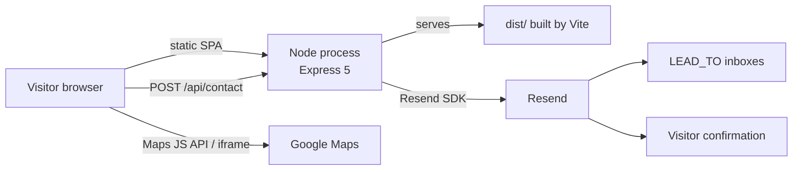

<div align="center">
  
  <h1>ROSE Technology — Corporate Website</h1>
  <p><b>Single-page corporate site with a contact API, multi-branch maps and nine languages</b><br/>Built for ROSE Technology, a systems repair and optimization center in Villavicencio, Bogotá and Cali (Colombia)</p>

  <p>
    <a href="README.md"></a>
    <a href="README.es.md"></a>
  </p>

  
  
  
  
  
  
  <a href="LICENSE"></a>

  <p>
    <a href="ARCHITECTURE.md">Architecture</a> ·
    <a href="SECURITY.md">Security</a> ·
    <a href="CHANGELOG.md">Changelog</a>
  </p>
</div>

## What it is

Institutional website for **ROSE** (trade name **ROSE Technology**, "Centro de Reparación y Optimización de Sistemas Empresariales"), a company that repairs and maintains business hardware and sells the **Myshop** admin software. It has three branches (*sedes*) in Villavicencio (main), Bogotá and Cali.

The goal is a fast brochure site that turns visitors into leads: it presents services, Myshop, products and team, shows the service coverage of each branch on a map, offers the commercial catalog as a PDF and sends every contact request by email to the sales team. There are no user accounts, payments or database: email is the system of record for leads.

## Features

| Area | What it does |
| --- | --- |
| Content | One-page layout with hero, about, services, Myshop, products, why us, team, coverage and contact sections; sticky nav with scroll-spy and mobile drawer. |
| Branches and maps | Branch selector for Villavicencio, Bogotá and Cali. `LocationMap` pins each HQ (Google Maps JavaScript API, or an embed iframe when there is no key). `CoverageMap` draws on-site and remote coverage polygons from `src/data/coverage.json`. |
| Contact form | Closed topics (diagnosis, quote, Myshop, products, advisory, maintenance), client and server validation, hidden honeypot, rate limit, lead email to `LEAD_TO` and confirmation email to the visitor through Resend. |
| Catalog | `BrochureDownload` serves `public/catalogo-rose-technology.pdf` from the header, nav and footer. |
| Internationalization | Nine locales (Spanish by default, English, French, Simplified Chinese, Brazilian Portuguese, German, Japanese, Italian and Korean) with a custom `I18nProvider` and JSON files, not i18next. The choice persists in `localStorage`. |
| Theme | Light and dark modes, initial `prefers-color-scheme`, persistence in `localStorage` (`rose-theme`) and an early script in `index.html` that sets `data-theme` and `color-scheme` before first paint (avoids issues with Samsung Internet Force Dark). Maps and logos follow the theme. |
| SEO and privacy | `LocalBusiness` JSON-LD, cookie notice, production logs without form PII. |

## Architecture



- **One deployable unit.** In production a single Node process serves the Vite build (`dist/`) and the `/api` routes, so there is one container, one `PORT` and one URL on the Render free plan. Locally, `npm run dev` runs Vite and Express side by side and Vite proxies `/api`.
- **Clear client/server trust boundary.** The Resend key is only read by Node and never uses a `VITE_` prefix. The Google Maps key is public by design, is inlined at build time and must be restricted by HTTP referrer.
- **No database.** Leads go to the `LEAD_TO` inboxes (with `CEO_EMAIL` as fallback); language, theme and coverage data live in `localStorage` and versioned GeoJSON.
- **Hardened contact endpoint.** Helmet with a strict CSP, CORS allowlist, 16 KB body cap, unknown JSON fields rejected, rate limit of 5 submissions per IP every 15 minutes (configurable) and HTML-escaped email templates.
- **Coverage from OpenStreetMap.** `scripts/fetch-coverage.mjs` queries Overpass on a developer machine and writes the polygons to `src/data/coverage.json`; the browser never calls OSM.

Design rationale, data flow and infrastructure details: [ARCHITECTURE.md](ARCHITECTURE.md).

## Tech stack

| Layer | Technology |
| --- | --- |
| UI | Vite 7, React 19, TypeScript 5.9, custom CSS (black, white and red `#e10600`) |
| Contact API | Express 5 (`server/index.mjs`), Helmet, CORS, express-rate-limit |
| Email | [Resend](https://resend.com/) SDK, server side only |
| Maps | Google Maps JavaScript API, with Maps Embed iframe fallback |
| i18n | Custom `I18nProvider` + JSON locales |
| Packaging | Multi-stage Docker image (`node:20-alpine`), Docker Compose |
| Hosting | Render, free plan, Docker runtime (`render.yaml`) |

## Getting started

Requirements: Node.js 20 or later.

```bash
npm install
```

Copy `.env.example` to `.env` at the **repository root** and fill in the values. Do not create `src/.env` and never prefix secrets with `VITE_`.

```bash
npm run dev
```

That command starts two processes: the contact API at `http://127.0.0.1:8787` and Vite at `http://localhost:5173`, which proxies `/api` to Express.

Frontend-only build:

```bash
npm run build
npm run preview
```

`npm run preview` serves `dist/` and still proxies `/api` to a separately running API. In production use `npm start` (or Docker) so one process serves `dist/` and the API.

### Scripts

| Script | What it does |
| --- | --- |
| `npm run dev` | API + Vite in parallel (`concurrently`) |
| `npm run dev:web` | Vite only |
| `npm run dev:api` | Express only |
| `npm run build` | TypeScript check and `dist/` |
| `npm run preview` | Serves `dist/` with proxy to the API |
| `npm start` | Production: static `dist/` + `/api` |

### Environment variables

Names and purpose are documented in `.env.example`. Never copy real keys into the README, issues, PDFs or `render.yaml`.

**Server (secrets)**

| Variable | Purpose |
| --- | --- |
| `RESEND_API_KEY` | Resend API key. Read by Node only. |
| `RESEND_FROM` | Sender. In production use a domain verified in Resend. |
| `LEAD_TO` | Comma-separated internal inboxes for each lead (preferred). |
| `CEO_EMAIL` | Fallback when `LEAD_TO` is empty. |
| `PORT` | HTTP port in production (Render sets it). Default `8787`. |
| `API_PORT` | Local API port when `PORT` is not set. Default `8787`. |
| `API_HOST` | Bind address: `127.0.0.1` locally, `0.0.0.0` in Docker/Render. |
| `FRONTEND_ORIGIN` | Extra CORS origins (comma-separated) besides the Vite localhost ports. |
| `RATE_LIMIT_WINDOW_MS` | Window for `POST /api/contact` in ms. Default 15 minutes. |
| `RATE_LIMIT_MAX` | Max submissions per IP in that window. Default 5. |
| `TRUST_PROXY` | Set to `1` behind a reverse proxy so `X-Forwarded-For` is trusted. |
| `NODE_ENV` | `production` in Docker/Render (hides form PII from logs). |

**Client (public by design, inlined at build time)**

| Variable | Purpose |
| --- | --- |
| `VITE_GOOGLE_MAPS_KEY` | Maps key. Restrict it by HTTP referrer and, if possible, to Maps JavaScript API and Maps Embed API only. Without it the site uses a Google Maps iframe. |
| `VITE_GOOGLE_MAPS_MAP_ID` | Optional Map ID for cloud styles and Advanced Markers. |

## Deployment

### Docker

Do not bake `.env` into the image. Runtime secrets come from `env_file` or the host environment; the Maps variables are build args because Vite inlines them.

```bash
docker compose up --build
```

The site is then available at `http://localhost:8787` (UI and `/api/contact` in one process).

Manual build:

```bash
docker build --build-arg VITE_GOOGLE_MAPS_KEY --build-arg VITE_GOOGLE_MAPS_MAP_ID -t rose-tech .
docker run --env-file .env -e NODE_ENV=production -e PORT=8787 -e API_HOST=0.0.0.0 -p 8787:8787 rose-tech
```

### Render

The [`render.yaml`](render.yaml) blueprint declares the `rose-tech` web service (Docker runtime, free plan, health check on `GET /api/health`). Values committed to Git: `NODE_ENV`, `TRUST_PROXY`, `API_HOST`. Values set in the dashboard (`sync: false`): `RESEND_API_KEY`, `RESEND_FROM`, `LEAD_TO`, `CEO_EMAIL`, `VITE_GOOGLE_MAPS_KEY`, `VITE_GOOGLE_MAPS_MAP_ID`, `FRONTEND_ORIGIN`.

After the first deploy, set `FRONTEND_ORIGIN` to `https://<service>.onrender.com` (no trailing slash) and redeploy. Changing `VITE_GOOGLE_MAPS_KEY` requires rebuilding the image.

Production checklist:

- Verify the sending domain in Resend; do not leave `onboarding@resend.dev` as the public sender.
- Restrict the Google Maps key to the HTTPS referrers of the real domain (localhost only for development).
- Set `FRONTEND_ORIGIN` to the real site URL.
- Deploy with `NODE_ENV=production` so form data is not logged.
- Review [SECURITY.md](SECURITY.md) before going live.

## Repository layout

```
public/brand/                        Brand assets used by the site and the emails
public/images/                       Service photos
public/catalogo-rose-technology.pdf  Downloadable catalog
server/                              Express API and email templates
scripts/fetch-coverage.mjs           Coverage polygons from OpenStreetMap
src/components/                      Header, maps, contact form, catalog, controls
src/content.ts                       Company data and the three branches
src/data/coverage.json               Coverage GeoJSON per branch
src/i18n/                            I18nProvider and locales/*.json
src/theme/                           Light / dark ThemeProvider
Dockerfile, docker-compose.yml       Production image and local run
render.yaml                          Render blueprint
ARCHITECTURE.md, SECURITY.md         Technical documentation
```

## Authorship

<table>
  <tr>
    <td align="center"><a href="https://github.com/Joan-Mora"><br/><b>Darwin Joan Aveiga Mora</b></a><br/><sub>Full-stack development and deployment</sub></td>
  </tr>
</table>

Developed for ROSE Technology (Villavicencio, Meta, Colombia).

## License

Copyright © 2026 Darwin Joan Aveiga Mora. **All rights reserved.**

This repository is public so the code can be reviewed as part of my portfolio. That does not grant permission to copy, reuse, modify, distribute or present it as your own work. The full terms are in [`LICENSE`](LICENSE). For any use, write to [darwin@abacore.co](mailto:darwin@abacore.co).

The source code is the work of Darwin Joan Aveiga Mora. The **ROSE** and **ROSE Technology** names, logos, catalog, photos and business content belong to ROSE Technology and are included only because they are part of the delivered site. The stock service photos in `public/images/` come from Unsplash and Pexels and keep their own licenses.

<div align="center">
<sub>Built by <a href="https://github.com/Joan-Mora">Darwin Aveiga</a> · <a href="https://abacore.co">Abacore S.A.S.</a></sub>
</div>
